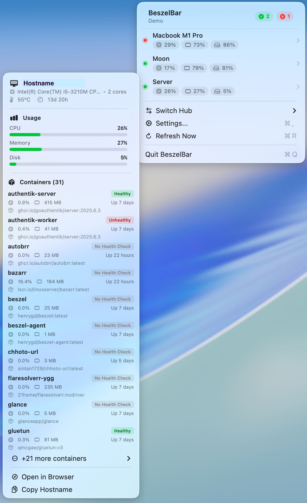

# BeszelBar

**Your Beszel servers at a glance from the menu bar.**

BeszelBar keeps your [Beszel](https://github.com/henrygd/beszel) infrastructure in view without opening a browser. Connect to your hubs and get a clear, glanceable dashboard for system health, resource usage, containers, and alerts right from the macOS menu bar.

## Installation

### Homebrew

```bash
brew install --cask loriage/tap/beszelbar
```

### Download

Download the latest release from the [Releases](https://github.com/Loriage/BeszelBar/releases) page.

The app is signed and notarized by Apple, so macOS should recognize it as a trusted build when you install it.

### Build from source

```bash
# Requires Xcode 15+ and xcodegen
brew install xcodegen
git clone https://github.com/Loriage/BeszelBar.git
cd BeszelBar
./build.sh
open build/Release/BeszelBar.app
```

The build script uses an installed Developer ID Application certificate, or an Apple Development certificate, so Keychain recognizes subsequent builds as the same app. Switching from an older ad-hoc build may require one final **Always Allow** approval.

To choose a specific certificate when several are installed, set `BESZELBAR_SIGNING_IDENTITY` to its name or SHA-1 hash when running `./build.sh`. The release workflow's `DEVELOPER_ID_APPLICATION` variable is also supported. Without a certificate, use `BESZELBAR_SIGNING_IDENTITY=- ./build.sh` explicitly; those ad-hoc builds may request Keychain authorization again after recompilation.

## Screenshot



## Features

- **Live system cards** — See all your servers with status indicators, CPU, memory, and disk at a glance
- **Rich system details** — Hover for detailed metrics including temperature, uptime, and usage bars
- **Container monitoring** — View Docker containers with health status, resource usage, and image info
- **Alert notifications** — Active alerts displayed prominently with triggering conditions
- **Dashboard window** — Open **Open Dashboard…** from the menu for system cards, searchable containers, and alert rules
- **iOS chart parity** — The same chart and card components as Beszel iOS: CPU and cores, memory/swap, storage and ZFS, network interfaces, sensors/GPU, and container history. Choose 1h, 12h, 24h, 7d, or 30d; unavailable hardware metrics stay hidden.
- **Multi-hub support** — Choose one hub or **All Hubs** in the menu and dashboard, with each system identified by its hub
- **Fallback URL** — Configure a primary and optional secondary address for the same hub; BeszelBar switches automatically when an address is unreachable
- **Native performance** — Built with SwiftUI and AppKit for minimal resource usage
- **Secure authentication** — Credentials stored safely in macOS Keychain
- **Auto-refresh** — Configurable polling interval from 10 seconds to 5 minutes

## Setup

1. Launch BeszelBar
2. Click the menu bar icon and open **Settings**
3. Add your Beszel hub's primary URL, email, and password. Optionally add a secondary URL pointing to the **same hub** (for example, a public HTTPS address alongside a local address).
4. Your servers appear in the menu bar dropdown. Choose **Open Dashboard…** for the full interface.
5. With multiple hubs, use **Show Hubs → All Hubs** or the dashboard sidebar to monitor them together.

The primary address is preferred. After a connection failure, the secondary address is used for 60 seconds before retrying the primary. HTTP errors, invalid credentials, and certificate errors do not trigger a switch. The dashboard indicates when the secondary URL is in use. Existing hubs keep working without adding a secondary URL.

BeszelBar supports both password and JWT token authentication. Tokens are automatically refreshed when needed.

## Requirements

- macOS 14.0 (Sonoma) or later
- A running [Beszel](https://github.com/henrygd/beszel) hub instance

## Development tests

```bash
xcodegen generate
xcodebuild -project BeszelBar.xcodeproj -scheme BeszelBar \
  -destination 'platform=macOS' CODE_SIGNING_ALLOWED=NO test
```

The isolated application-hosted test suite covers hub isolation, cancelled refreshes, pagination, historical samples, URL fallback, and storage migration without accessing a real hub or the Keychain. For local UI testing, Debug builds optionally accept a `TestingHubs.json` resource in the built app bundle with `hubs` (`name`, `url`, optional `fallbackURL`, `email`, `password`) and `allHubs`. This uses isolated preferences and in-memory credentials; keep the file outside source control and re-sign the local bundle after adding it. Release builds do not include this bootstrap.

## Acknowledgements

A huge thank you to [henrygd](https://github.com/henrygd) for creating Beszel, a fantastic, lightweight, and open-source monitoring tool. This macOS client would not exist without his remarkable work.

## License

MIT License — see [LICENSE](LICENSE) for details.

### Dashboard charts

The overview includes a system selector and the complete chart catalog. Filter by category or pin charts for quick access. In Containers, choose a container to view its individual CPU and memory histories alongside the three aggregate charts. Opening an aggregate container chart in the dashboard exposes the iOS detail chart and values table. Pins are scoped by both hub and system.

The port preserves Beszel iOS chart layouts, legends, gradients, units, and card surfaces, with explicit iOS font sizes on macOS. See [the parity inventory](docs/ios-chart-parity.md) for provenance and coverage.

Run the test scheme with `xcodebuild -project BeszelBar.xcodeproj -scheme BeszelBar -destination 'platform=macOS' test`. It uses an isolated application host and produces native SwiftUI chart renders in `build/screenshots-ios/renders`. The live integration test is opt-in through the ignored `build/LiveChartsTestConfig.json`; without it, only that test is skipped. Rendering tests are not a substitute for interactive window testing.
